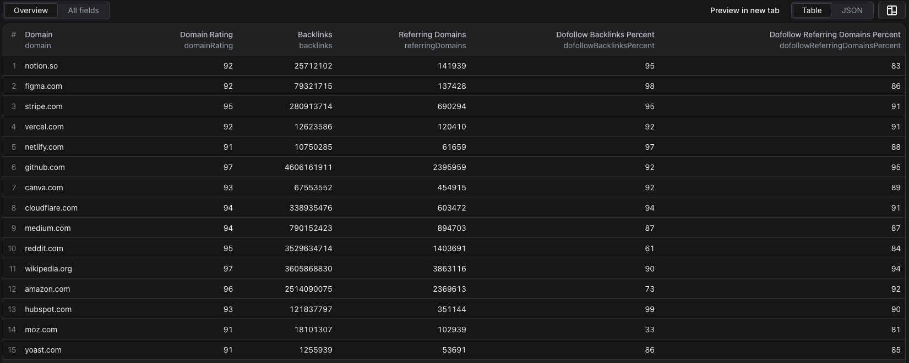

# How to Check Ahrefs Domain Rating in Node.js

This example calls the [Ahrefs Domain Rating Scraper](https://apify.com/piotrv1001/ahrefs-domain-rating-scraper) on Apify. It uses the existing Actor; it does not implement a scraper.



The screenshot is from a separate fifteen-domain run. The code below uses a smaller three-domain starter input.

## What this example does

- Sends three domains to the Actor.
- Waits for the run to finish.
- Reads and prints the dataset rows.

Each row can include Domain Rating, backlink and referring-domain counts, and dofollow percentages. A DR score is a backlink-profile signal, not a verdict on site quality.

## Prerequisites

- Node.js 18 or newer
- An Apify account and [API token](https://console.apify.com/settings/integrations)

## Installation

```bash
npm install
```

## Environment setup

Copy `.env.example` to `.env` and replace the placeholder with your token.

## Usage

```bash
npm start
```

The Actor bills per domain or URL checked. See its [live pricing](https://apify.com/piotrv1001/ahrefs-domain-rating-scraper/pricing) before increasing the list.

## Code example

```js
import { ApifyClient } from 'apify-client';
import 'dotenv/config';

if (!process.env.APIFY_TOKEN) {
    throw new Error('Set APIFY_TOKEN in .env before running this example.');
}

const client = new ApifyClient({ token: process.env.APIFY_TOKEN });

const input = {
    domains: ['apify.com', 'ahrefs.com', 'semrush.com'],
    maxItems: 3,
};

const run = await client.actor('piotrv1001/ahrefs-domain-rating-scraper').call(input);

console.log('Results from dataset');
console.log(`Check your data here: https://console.apify.com/storage/datasets/${run.defaultDatasetId}`);
const { items } = await client.dataset(run.defaultDatasetId).listItems();
items.forEach((item) => console.dir(item));

// API client docs: https://docs.apify.com/api/client/js/docs
```

## Example output

[`sample-output.json`](sample-output.json) contains **illustrative mock values**, not a captured run. It shows the row shape: `domain`, `scope`, `domainRating`, `backlinks`, `referringDomains`, and dofollow percentages. Replace it with a real export after running the Actor.

## Use cases

- Triage a guest-post prospect list.
- Compare backlink profiles across competitors.
- Enrich a spreadsheet of possible partners.
- Flag sites for manual review before outreach.

## Try the Actor on Apify

**[Open Ahrefs Domain Rating Scraper on Apify](https://apify.com/piotrv1001/ahrefs-domain-rating-scraper)**

## Related resources

- [How to check Ahrefs Domain Rating in bulk](https://www.falconscrape.com/blog/how-to-check-ahrefs-domain-rating-in-bulk)

## License

MIT
